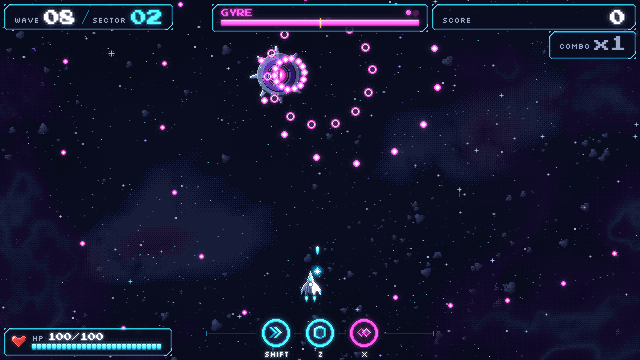
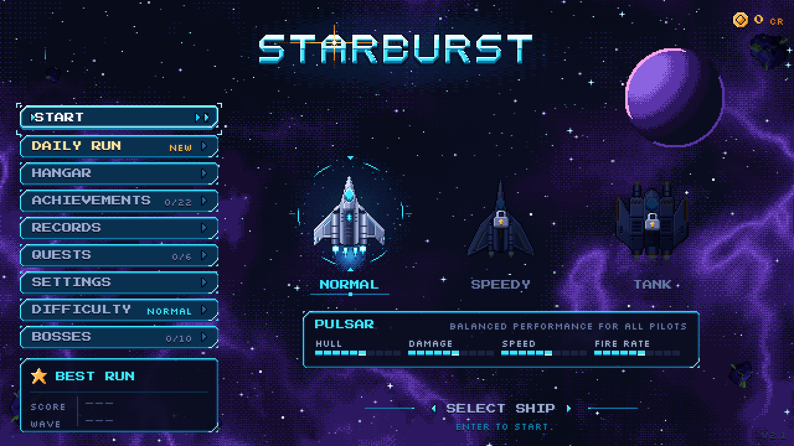
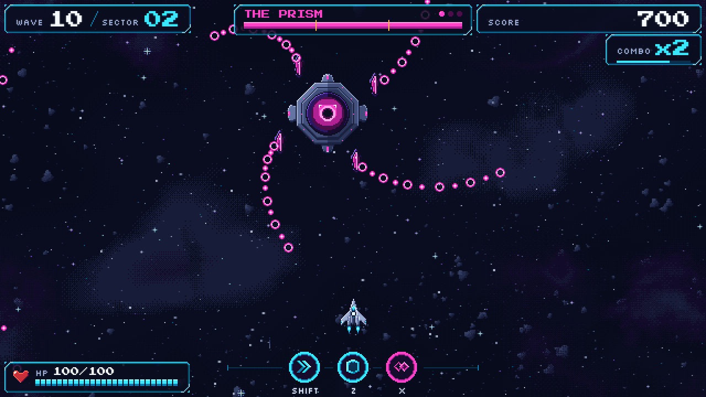

# StarBurst

A neon pixel-art bullet hell. Dodge dense bullet patterns, graze for combo, fight bosses, and build a stronger ship between waves.

**[▶ Play in browser](https://kpetrovski.me/play/starburst/)** · [itch.io](https://kirilp.itch.io/starburst)






## Features

- **Hand-placed pixel art** at a native 640×360, scaled with whole-pixel steps so every pixel is the same size.
- **Readable bullet patterns**: orbs, rings, needles, and shards each have their own shape. Your true hitbox is a small marked dot, and near misses (grazes) build your combo.
- **Three ships**: Pulsar (balanced), Nova Dart (fast and fragile), and Titan (heavy armour). Each has its own hull, speed, damage, and fire rate.
- **Upgrades between waves**: unlock and level up dash, forcefield, and phase shift, plus thrusters and hull repairs.
- **Bosses every 5th wave** with telegraphed attacks and phase changes. After the authored waves, endless mode keeps scaling up.
- **Quests, best runs, and three difficulty levels.**
- **Accessibility options**:
  - Rebind any key.
  - Use a high-contrast or colour-blind-safe orange bullet palette.
  - Turn on assist mode.
  - Turn off flashes and screen shake.
  - Lower graphics quality and show an FPS counter.
- **Plays anywhere**: keyboard, gamepad, and touch controls. It installs as an app (PWA) and works offline after the first visit.

## Controls

| Action | Keyboard (default) | Gamepad | Touch |
|---|---|---|---|
| Move | Arrow keys / WASD | Left stick / D-pad | Drag on the left side of the screen |
| Fire (hold) | Space | A / RT | FIRE button |
| Dash | Shift | LB / RB / LT | Dash button |
| Forcefield | Z | X | Shield button |
| Phase shift | X | Y | Phase button |
| Pause | Esc | B / Start | Pause button (top centre) |
| Fullscreen | F | | |

- To change keys, go to **Settings → Controls**. Each action can have two keys. Menus, gamepads, and touch controls always use the default layout, so a bad binding can always be fixed from the menu.
- Your ship always faces and fires straight up the screen. Movement is everything: line up your shots by flying under things.
- To make enemy bullets easier to see, set **Settings → Enemy bullets** to **Contrast** (white cores and dark outlines) or **Orange** (every hostile bullet turns orange, against your cyan shots).
- **Settings → Assist mode** slows enemy bullets, gives you 50% more hull, and widens the graze window. The run is labelled **ASSIST MODE** on screen, and the save marks it as not leaderboard-eligible.

Survive the timed waves and pick an upgrade after each one.

Originally made for **Bullet Hell Jam 6**.

## Development

Built with JavaScript, Phaser 3.90, and Vite. Everything, including Phaser and the fonts, is bundled locally, so the game works offline.

```sh
npm install
npm run dev              # dev server with hot reload (http://localhost:5173, ?scene=Game jumps straight into a run)
npm run build            # production build in dist/ (relative paths: upload the folder anywhere, e.g. itch.io)
npm run preview          # serve the production build
npm run check            # static checks: syntax, sprite maps, texture contract, PWA manifest
npm run test:smoke       # headless smoke test of the whole game loop (needs Chrome; set CHROME_PATH if not found)
npm run test:smoke:prod  # same, plus the production bundle and its service worker
npm run gif              # re-record docs/media/gameplay.gif (needs ffmpeg)
npm run icons            # regenerate favicon / PWA icons from the pixel-art source
```

CI (`.github/workflows/ci.yml`) runs `check`, `build`, and the smoke test on every push and pull request. It uploads the build as the `starburst-dist` artifact.

There are a few more tools: `node tools/shot.mjs` takes screenshots of the running game, `node tools/render-sprites.mjs` renders sprite sheets, and `node tools/qa.mjs` runs a leak and flow check over every screen. In dev builds, `window.__dbg` exposes test hooks (`skipToWave`, `boss`, `godMode`, `spray`, …).

Here's where things live:
- Scenes: `src/scenes/`
- Gameplay (player, enemies, waves, bosses, bullets): `src/objects/`
- Systems (save, input bindings, audio, quality): `src/systems/`
- Pixel art (text-map sprites, baked at startup): `src/art/`
- Audio: `public/assets/audio/`

Before you change visuals or code structure, read `docs/STYLE.md` and `docs/ARCHITECTURE.md`.

## Credits

- Design, code, and art: Kiril Petrovski
- Engine: [Phaser](https://phaser.io) 3.90 (MIT). Build tool: [Vite](https://vite.dev) (MIT).
- Fonts (SIL Open Font License, via [Fontsource](https://fontsource.org)):
  - [Press Start 2P](https://fonts.google.com/specimen/Press+Start+2P) by CodeMan38
  - [Silkscreen](https://fonts.google.com/specimen/Silkscreen) by Jason Kottke
- Music and sound effects: from the original Bullet Hell Jam 6 release. Extra UI and feedback sounds are synthesized at runtime.
