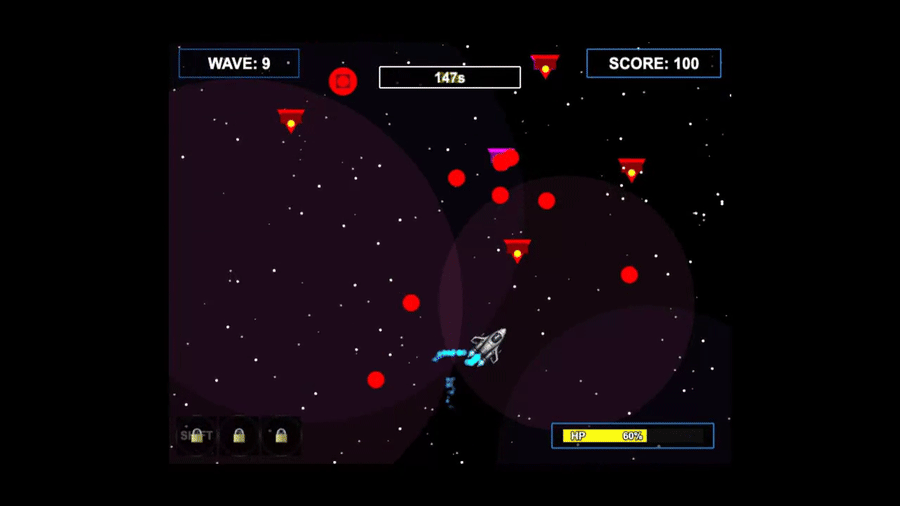
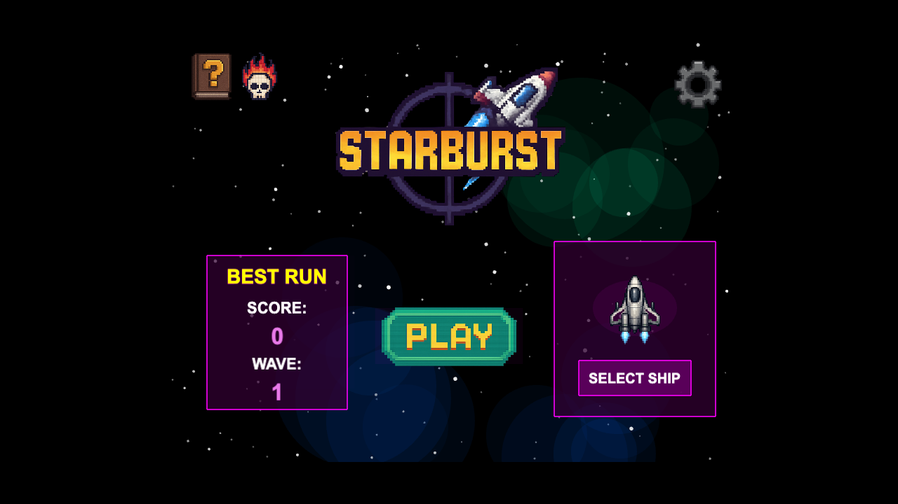
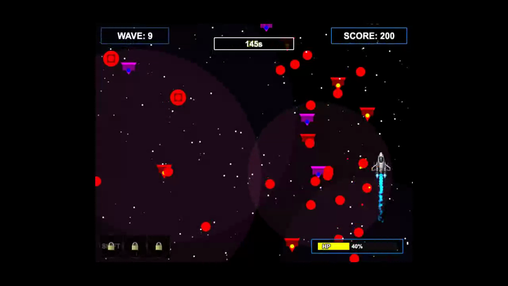

# StarBurst



Dodge bullet patterns, fight bosses, and build a stronger ship between waves.

**[▶ Play in browser](https://kpetrovski.me/play/starburst/)** · [itch.io](https://kirilp.itch.io/starburst)




## How to play

- **Arrow keys** or **WASD** move your ship.
- **Space** fires (hold).
- When unlocked, **Shift** dashes, **Z** activates a forcefield, and **X** activates phase shift.
- **Esc** pauses, **F** toggles fullscreen.
- **Gamepad**: stick/D-pad move, A/RT fire, LB/RB dash, X forcefield, Y phase shift, B/Start pause. Touch screens get on-screen controls.
- Survive timed waves and choose upgrades between them.

Created for **Bullet Hell Jam 6**.

## Development

Built with JavaScript, Phaser 3.90 and Vite. Phaser is bundled locally, so it works offline.

```sh
npm install
npm run dev      # dev server with hot reload
npm run build    # production build in dist/
```

Game scenes live in `src/scenes/`; player, enemies, and wave logic live in `src/objects/`. Static assets are in `public/assets/`.
